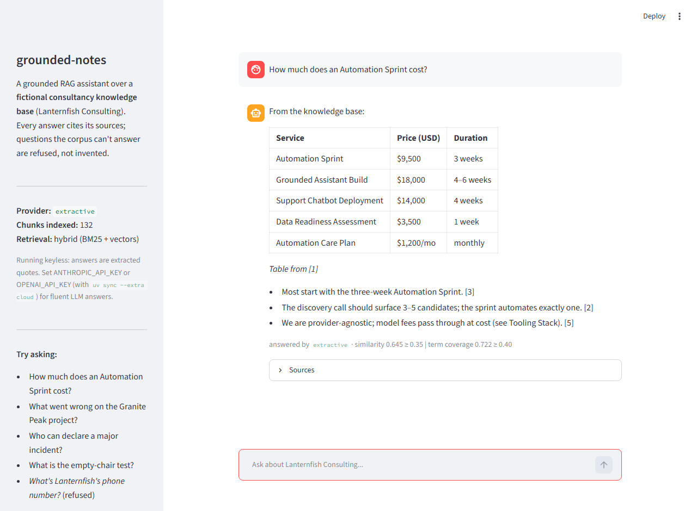

# grounded-notes

[](https://github.com/vybetechlabs-blip/grounded-notes/actions/workflows/ci.yml)

**Live demo:** [grounded-notes.streamlit.app](https://grounded-notes.streamlit.app). Free hosting, so the first load may take a moment. No sign-in and no API key.

## Problem and result
An assistant that answers from documents has to show where each answer came from, and say so when the documents do not contain it. grounded-notes cites the file and heading for every answer and refuses instead of guessing.

The corpus is 25 synthetic documents for a fictional consultancy, which become 132 chunks after ingestion. Retrieval is hybrid: BM25 and vector search fused by reciprocal-rank fusion. A two-signal grounding check refuses before any answer is written. The committed eval has 19 cases. Hit-rate@5 is 100% on the 15 answerable questions, and all 4 out-of-corpus questions are refused. The suite has 38 tests. The hosted demo needs no API key: its answers are quotes extracted from the retrieved passages.


### How it works
A question goes through retrieval, then the grounding check, then the answerer, as the diagram shows:

```
corpus/*.md ──▶ loader ──▶ chunker ──▶ embeddings (sentence-transformers, CPU)
                (frontmatter) (heading-aware)      │
                                                   ▼
                                        Chroma (data/chroma, idempotent sync)
                                                   │
question ──▶ BM25 ──┐                              │
        └──▶ vector ┴─▶ RRF fusion + term-coverage guarantee
                              │
                              ▼
                    grounding guard (2 signals) ──✗──▶ refusal + closest docs
                              │ ✓
                              ▼
                    provider (extractive | Claude | OpenAI)
                              │
                              ▼
                    answer + numbered citations (file + heading)
```

The package follows the pipeline: `ragkit/ingest`, `embed`, `store`, `retrieve`, `generate`, `grounding`, with `pipeline.py` tying them together and two frontends, `cli.py` and `app.py`. Chunks are split on headings, carry their heading trail, and get content-hash ids, so re-ingesting is a sync: unchanged chunks are skipped and removed content is deleted from the index. The eval results below are reproduced by `uv run ragkit eval`.

| Metric                             | Result | Cases                     |
| ---------------------------------- | ------ | ------------------------- |
| Retrieval hit-rate@5               | 100%   | 15 answerable questions   |
| Refusal accuracy (grounding guard) | 100%   | 4 out-of-corpus questions |
| Grounding accuracy overall         | 100%   | 19                        |

## Decision log
**1. Hybrid retrieval, with the reranker off.**
Chosen: BM25 and vector search fused by reciprocal-rank fusion. Fusion decides the order, and every returned chunk keeps its true cosine similarity, so the grounding threshold keeps one meaning. If the top 5 lack the query's rarest informative term and a lower-ranked chunk has it, that chunk is swapped in.
Rejected: vector search alone, which blurs exact tokens such as names and headings. Also rejected: a cross-encoder reranker. It is implemented (`RAGKIT_RERANK=true`) and off by default. With it on, hit-rate@5 falls from 100% to 93% and overall grounding accuracy from 100% to 95%, because the discounts question loses its source chunk.

**2. A grounding guard with two signals.**
Chosen: refuse when the best cosine similarity is below 0.35, or when the IDF-weighted coverage of the question's informative terms in the retrieved chunks is below 0.40. Refusals happen before any answer is written, and the reason is shown.
Rejected: a single similarity threshold. Answerable eval questions score between 0.395 and 0.732, and the out-of-corpus question about a street address and phone number scores 0.497, inside that range. Its term coverage is 0.358, under the 0.40 floor, so the second signal refuses it.
Known limits: coverage is a vocabulary check. Asking for the street address alone passes (similarity 0.486, coverage 0.619) and gets an extractive answer, because "address" appears elsewhere in the corpus. A heavily paraphrased question that shares no words with the corpus could be refused by mistake. Both thresholds were set against this eval, so recalibrate them when the corpus changes.

**3. Keyless extractive answers by default.**
Chosen: the default answerer quotes the most query-similar sentences from the retrieved chunks, with citations. The hosted demo runs this way. Claude and OpenAI answer modes exist for local runs only.
Rejected: a hosted model behind the public link. The key owner would pay for every visitor's questions. Extractive answers only repeat text from the corpus. The cost is fluency.

**4. A synthetic corpus.**
Chosen: 25 invented documents for a fictional consultancy, Lanternfish Consulting: SOPs, delivery playbooks, project retrospectives and FAQs that cross-reference each other, so questions that span documents can be tested.
Rejected: real or scraped documents. Shipping the data makes every eval case checkable by reading the cited document, and there is no privacy or licensing question.

**5. Repair this repo as the public demo of the Cortex design.**
Chosen: Cortex is a private project built on the same hybrid retrieval design, and it stays private. This repo already ran that design on a corpus it can ship, with evals and a hosted deploy, so it was kept and repaired as the public demo.
Rejected: a hosted demo of Cortex itself, which a private project cannot be, and a new demo built from scratch, which would repeat work this repo already did.

## How AI was used
I built this as a proof of concept to understand how grounded retrieval actually behaves once you put constraints on it: answers must come from the document set, every answer must cite its source, and the system must refuse rather than guess. I wrote the spec and the constraints, and Claude Code wrote most of the code: the retrieval layer, the eval harness and the Streamlit app. I reviewed each checkpoint and kept the decisions. Claude Code proposed hybrid BM25 + vector retrieval and the eval suite; I accepted both because the eval set includes exact-term questions that pure vector retrieval handles poorly, and I wanted a pass/fail number for grounding before I trusted any answer the app gave. Two later decisions shaped the repo more than the code did. I moved hosting from Hugging Face Spaces to Streamlit Community Cloud when the free Spaces tier turned out not to run a Python backend, and I kept the hosted demo extractive-only rather than wiring in an API key, so the public link runs with no spend and the model-backed mode stays a local option. One bug surfaced in production that the evals did not catch: markdown tables rendered flat because whitespace was being collapsed before display. Claude Code traced it and proposed a fix in the extractive answer-formatting layer; I accepted it because the change didn't touch retrieval or grounding and the eval scores stayed at 100 after it. The lesson I took is that a green eval suite says nothing about rendering.

## Run it locally
You need [git](https://git-scm.com/) and [uv](https://docs.astral.sh/uv/). The first run installs the dependencies, downloads the embedding model and builds the index from `corpus/` on its own.

```bash
git clone https://github.com/vybetechlabs-blip/grounded-notes.git
cd grounded-notes
uv run streamlit run app.py
```

The chat UI opens at `localhost:8501`. It needs no key and no account: embeddings run on CPU and answers are extractive. Other commands are below. The tests use a fake embedder and never touch the network.

```bash
uv run ragkit ingest              # idempotent corpus sync
uv run ragkit query "How much does an Automation Sprint cost?"   # cited answer or refusal
uv run ragkit eval                # committed cases; non-zero exit below the ship thresholds
uv run pytest                     # 38 tests; one is skipped unless the cloud extra is installed
uv run ruff check . && uv run ruff format --check .
```

### Model-backed answers (local only)
The hosted demo is extractive only. To try model-backed answers on your own machine, install the optional extra and set a key in your shell environment:

```bash
uv sync --extra cloud
export ANTHROPIC_API_KEY=<your key>      # or OPENAI_API_KEY
uv run streamlit run app.py
```

The sidebar names the active provider. If a model call fails, the app falls back to extractive answers. Other settings are listed in [`.env.example`](.env.example).

### Deploy your own copy (Streamlit Community Cloud)
1. Go to [share.streamlit.io](https://share.streamlit.io) and sign in with the GitHub account that owns the repo.
2. Choose **New app**, then the repository, branch `main` and main file `app.py`.
3. Under **Advanced settings**, pick Python 3.12.
4. Deploy. Community Cloud uses the first dependency file it finds, in this order: `uv.lock`, `Pipfile`, `environment.yml`, `requirements.txt`, `pyproject.toml`. So `uv.lock` is what installs. `requirements.txt` is an export of `uv.lock` for pip users: regenerate it with `uv export --no-dev --no-hashes -o requirements.txt`, then re-add the first line, `--extra-index-url https://download.pytorch.org/whl/cpu`. The first boot downloads the embedding model and builds the index.
5. Leave **Secrets** empty. The hosted app is extractive only, and model-backed answers are a local option (see above).

License: MIT, see [LICENSE](LICENSE). The Lanternfish Consulting corpus is fictional; any resemblance to real companies or people is coincidental.

## Status
**Status: Complete.** The eval passes on all 19 cases. The test and lint commands are listed under Run it locally.
